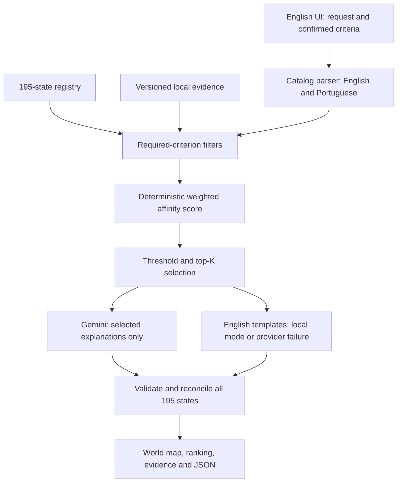

# JEV architecture — explainable global affinity search

The user confirms supported criteria, requirements, preferences and weights.
JEV calculates deterministic scores from a versioned local snapshot and selects
candidates. Gemini optionally explains only the selected subset, using typed
evidence. English is the default presentation and explanation language.

## Responsibilities

| Component | Responsibility |
| --- | --- |
| `country_registry` | Explicit registry of 193 UN members plus VAT and PSE; ISO and M49 codes |
| `affinity_schema` | Strict requests, evidence, factors, scores, selection, explanations and run metadata |
| `input_parser` | Conservative English/Portuguese phrases, negation and clarification |
| `evidence_service` | Local loading, integrity checks and English evidence presentation |
| `affinity_ranker` | Requirements, complete-data policy, weighted scoring and ISO tie-breaking |
| `jev_service` | Orchestration, templates, selection, cache, atomic checkpoints and cancellation |
| `explanation_client` | Bounded Gemini request and exact country/evidence reconciliation |
| `presentation` | English criterion labels, evidence notes, presentation and prompt versions |
| Streamlit and `affinity_map` | Criteria review, status-aware map, ranking, provenance and export |

The ranker has no UI or LLM SDK dependency. Acquisition is an explicit command
outside ranking. For this data volume, local JSON/JSONL is sufficient; no server
database, embeddings runtime or model container is required.

## Invariants

- Final results represent exactly the 195 registry states once each.
- Ranked countries have finite scores from 0 to 100. Exclusions, insufficient
  data and technical errors have null scores. Missing values never become zero.
- Scores describe affinity with one confirmed request, not probabilities.
  Scores from different requests are not directly comparable.
- Requirements filter; preferences alone contribute to the weighted average.
  Countries need evidence for every active criterion unless an observed failed
  requirement already establishes exclusion. Ties use ISO code order.
- Candidate selection uses an explicit threshold and limits. It does not fill
  top K artificially. The LLM receives only `explanation_ids`, never the registry.
- LLM output cannot add countries, change scores or reorder results. Failure
  preserves ranking and uses clearly identified English templates.
- `local_only` prevents external calls from the engine and explanation stage.
  The browser still loads Plotly basemap geometry from a CDN.
- Session caches and checkpoints include request, dataset, scoring, selection,
  presentation and prompt identities. An English release does not reuse older
  Portuguese explanations. Source snapshots and their hashes remain unchanged.

## Implementation and evaluation

`src/app.py` runs the JEV experience. `src/legacy_app.py` preserves the original
Gemini-scored MVP. The historical snapshot has coastline evidence for 195 states
and official-English evidence for 133; current factual validity requires review.
The offline evaluation is synthetic and functional. Live provider comparison,
cost and human review remain in [the handoff](docs/HANDOFF.md).

See [contracts](docs/JEV_DESIGN.md), [data policies](data/SOURCES.md),
[English experience notes](docs/ENGLISH_EXPERIENCE.md),
[ADR 0003](docs/adr/0003-affinity-ranking.md) and
[ADR 0004](docs/adr/0004-local-affinity-data.md).
